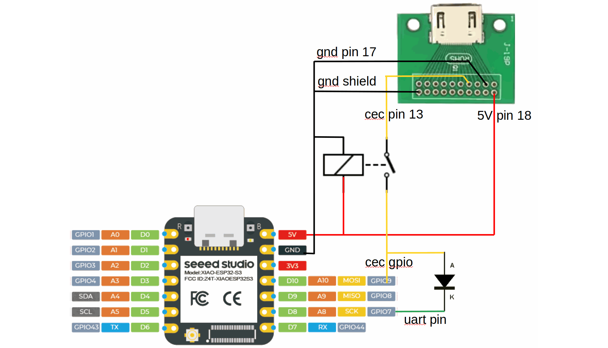
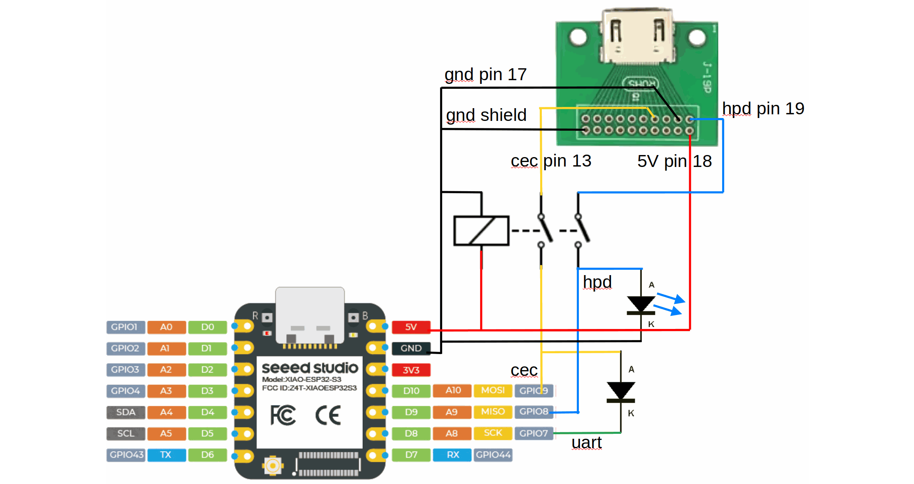

The `hdmi_cec` component connects an ESPHome device to the HDMI-CEC bus, so it can receive the messages
that travel between a TV and the devices attached to it, and send messages of its own: power a device on or
off, press a button on the TV's remote, select an input, change the volume.

HDMI-CEC (Consumer Electronics Control) is a single wire in every HDMI cable, present as pin 13 of the
connector. The wire is shared by all devices on an HDMI link, including those behind an A/V receiver or an
HDMI switch, so one ESPHome device plugged into a spare HDMI port of the TV reaches every one of them. The
bus is bidirectional, multi-master, and uses 3.3V signalling at a low bit rate, so a single GPIO pin is
enough.

## Wiring

- A GPIO pin that can be both input and output, to HDMI pin 13 (CEC)
- GND to HDMI pin 17 (DDC/CEC ground)
- *Optional but recommended*: the board's 5V supply to HDMI pin 18, which tells the TV or receiver that
  something is connected and alive

An HDMI breakout board makes the connector easy to reach. The component configures the pin as an
open-drain output with a weak pull-up, so no extra parts are needed for a first try; see
[Extended installation](#extended-installation) for a more robust connection.

## Configuration

```yaml
# Example configuration entry
hdmi_cec:
  id: cec
  pin: GPIOXX
  address: 0x5
```

The examples below assume `id: cec`.

### Configuration Variables

- **pin** (**Required**, [Pin Schema](/guides/configuration-types#pin-schema)): The GPIO pin wired to the CEC
  line.
- **address** (**Required**, int): The logical address the device answers to, `0x0` to `0xF`. `0x5` is an
  audio system, `0x4` a playback device, `0xF` the unregistered address; a device that only listens uses it
  together with `monitor_mode: true`, as `0xF` alone still acknowledges broadcasts.
- **promiscuous_mode** (*Optional*, boolean): Also hand messages addressed to other devices to `on_message`.
  Defaults to `false`: only broadcasts and messages for this device's address are seen.
- **monitor_mode** (*Optional*, boolean): Listen without taking part in the bus: no acknowledge is sent for
  messages addressed to this device, and `hdmi_cec.send` does nothing. Defaults to `false`.
- **on_message** (*Optional*, [Automation](/automations/)): Automations to run for received messages, each
  with optional filters:
  - **source** (*Optional*, int): Only messages from this logical address.
  - **destination** (*Optional*, int): Only messages to this logical address.
  - **opcode** (*Optional*, int): Only messages with this opcode.
  - **data** (*Optional*, list of int): Only messages whose payload starts with these bytes, the opcode
    first.

Inside the automation, `source` and `destination` are the logical addresses of the message as `uint8_t`,
and `data` is the payload starting with the opcode as a `std::span<const uint8_t>`. The payload is only
valid while the automation runs; copy it if a later action needs it.

> [!NOTE]
> This component does not answer the TV's questions on its own. A TV asks a new device for its physical
> address, OSD name, vendor id and power status, and marks it absent when nothing comes back. Answer the
> ones your TV needs with `on_message` automations; see [Example: Answer the TV](#example-answer-the-tv).

## `hdmi_cec.send` Action

Queues a message for transmission. Up to four messages wait in the queue while the bus is busy. A message is
sent bit by bit from the main loop, which takes about 25 ms per byte, so the loop pauses for up to 400 ms while
a message goes out; a warning about a slow operation during a send is expected.

```yaml
button:
  - platform: template
    name: "Turn everything off"
    on_press:
      - hdmi_cec.send:
          destination: 0xF  # broadcast
          data: [0x36]  # Standby
```

- **destination** (**Required**, int, [templatable](/automations/templates#config-templatable)): The logical
  address to send to, `0xF` for a broadcast.
- **data** (**Required**, list of int, [templatable](/automations/templates#config-templatable)): The
  payload, the opcode first, up to 15 bytes. A lambda returns a `std::vector<uint8_t>`.

The same is available in lambdas as `id(cec).send(destination, {opcode, ...})`. Both report the message in
the log once it is sent or when it was not acknowledged.

## Example: Answer the TV

```yaml
hdmi_cec:
  id: cec
  pin: GPIOXX
  address: 0x5
  on_message:
    - opcode: 0x8F  # Give Device Power Status
      then:
        - hdmi_cec.send:
            destination: !lambda return source;
            data: [0x90, 0x00]  # Report Power Status: on
```

## Example: TV Power and Volume

```yaml
button:
  - platform: template
    name: "TV Power On"
    on_press:
      - hdmi_cec.send:
          destination: 0x0  # the TV
          data: [0x44, 0x6D]  # User Control Pressed: Power On
      - hdmi_cec.send:
          destination: 0x0
          data: [0x45]  # User Control Released, or the TV treats the key as held
  - platform: template
    name: "TV Volume Up"
    on_press:
      - hdmi_cec.send:
          destination: 0x0
          data: [0x44, 0x41]  # User Control Pressed: Volume Up
      - hdmi_cec.send:
          destination: 0x0
          data: [0x45]  # User Control Released
  - platform: template
    name: "TV Volume Down"
    on_press:
      - lambda: |-  # User Control Pressed: Volume Down, then Released
          id(cec).send(0x0, {0x44, 0x42});
          id(cec).send(0x0, {0x45});
```

Not every TV honours every command; the log shows what was sent and received:

```text
[D][hdmi_cec:089]: Sending: 50:44:41
[D][hdmi_cec:123]: Send frame success in 1 attempt
[D][hdmi_cec:056]: Received: 05:8F
[D][hdmi_cec:089]: Sending: 50:90:00
```

## Example: Send from Home Assistant

```yaml
api:
  actions:
    - action: hdmi_cec_send
      variables:
        cec_destination: int
        cec_data: int[]
      then:
        - hdmi_cec.send:
            destination: !lambda return cec_destination;
            data: !lambda return std::vector<uint8_t>(cec_data.begin(), cec_data.end());
```

## Extended Installation

Two additions make the connection more robust.



### Disconnect from the CEC Line on Power-Down

The CEC line stays at 3.3V while the TV is on. A GPIO pin must not see a voltage above the device's own
supply, so with the ESPHome device powered off the line is outside the pin's operating conditions. This is
often ignored, at the risk of damaging the microcontroller or disturbing the other devices on the bus.

The schematic shows a small signal relay (a TQ2-5V or G6K-2P-5V, for instance) that disconnects the GPIO
from the CEC line when the power is off. An I²C level shifter such as the TXS0102 or TCA9517 does the same
job: it tolerates a bus voltage without local power, and its open-drain behaviour matches the CEC bus.

The diode and the second pin in the schematic are for driving the line from a UART, an option that is not
part of this component yet; they can be left out.

### Connect the HDMI Hot Plug Detect Pin

HDMI pin 19, Hot Plug Detect, is not part of CEC but tells when the cable is plugged into a TV. The TV
drives it to 5V through a 1K resistor, so it has to be limited to 3.3V before it reaches a GPIO: a
resistor divider (for example 10K to the pin and 20K from the pin to ground) or a 3.3V zener diode with a
series resistor. The LED in the schematic below only shows the connection; its forward voltage is not a
specification, so do not rely on it alone to protect the input.



Configure the pin with a weak pull-down for a defined level when nothing is connected, and add `delayed`
filters: the signal bounces while plugging, and the TV pulls it low for a moment during address discovery.

```yaml
binary_sensor:
  - platform: gpio
    pin:
      number: GPIOXX
      mode:
        input: true
        pulldown: true
    name: "HDMI Connected"
    filters:
      - delayed_on: 300ms
      - delayed_off: 300ms
```

## Note on the HDMI Standard

The HDMI 1.3a specification, available from [hdmi.org](https://www.hdmi.org), describes the CEC messages in
*Supplement 1, Consumer Electronics Control*. Later versions are not public.

Marketing a product as **HDMI** needs a licence from the HDMI organisation; the component itself is
available under the ESPHome licence.

## Platform Compatibility

- ESP32-S3 and ESP32-C3: tested with the `arduino` and `esp-idf` frameworks
- ESP8266: tested. The acknowledge bit is timed with hardware timer 1, which `esp8266_pwm`, `ac_dimmer`,
  `lightwaverf` and `opentherm` use as well, along with the Arduino core's `tone` and servo outputs, so do not
  combine them with this component.
- RP2040 and LibreTiny boards: compiled, not tested

## Acknowledgements

- johnboiles' [esphome-hdmi-cec](https://github.com/johnboiles/esphome-hdmi-cec) was the starting point.
- Palakis' [Native HDMI-CEC component](https://github.com/Palakis/esphome-native-hdmi-cec) made it
  self-contained and added the interrupt driven receiver.

This component continues Palakis' code with a transmit queue, retries spread over loop passes, and the
collision detection the standard asks for.
